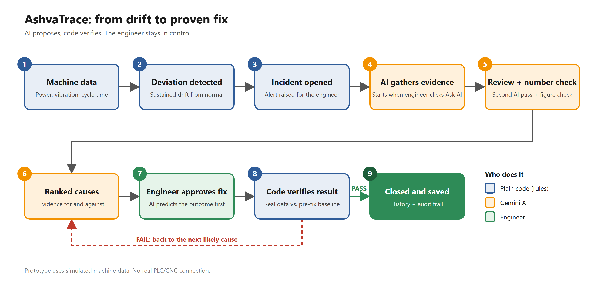
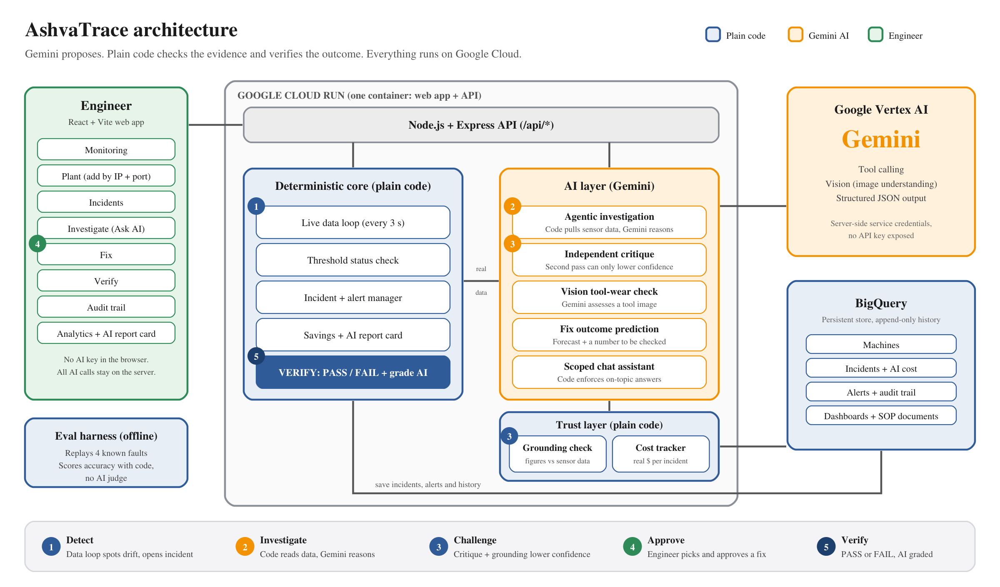

# AshvaTrace: Submission Answers

AI Builder Cup 2026, Manufacturing theme: Intelligent Operations & Industrial Efficiency

- Live app: https://ashvatrace-206380300251.us-central1.run.app
- Code: https://github.com/akanthed/AshvaTrace

---

## 1. Brief about the idea

- Factory machines waste power and break down quietly before anyone notices.
- AshvaTrace watches each machine's power use and flags it when it drifts from normal.
- AI then suggests the likely causes and shows its evidence.
- The engineer picks a fix.
- Before the fix, the AI commits to a number (for example "power should settle near 1.5%").
- Plain code, not AI, checks whether the fix worked.
  - After the fix, fixed rules compare the machine's real power, vibration and cycle-time readings against the readings from before the fix.
  - The code also scores the AI's own prediction against what was measured.
  - The result is a clear PASS or FAIL. The AI cannot overrule it, so the engineer gets an honest answer, not an AI's opinion of its own advice.

**In one line:** it spots the problem, explains it, proves the fix, and keeps score on the AI.

---

## 2. How is it different from existing ideas?

- **Other tools:** they show charts and alarms, then leave the diagnosis to people.
- **Other AI tools:** they give a chat answer you have to take on trust.
- **AshvaTrace:**
  - The AI reads real sensor data before it answers.
  - A second AI reviews the first one's work.
  - Code checks that every number quoted is real.
  - Code, not AI, decides if the fix worked.

---

## 3. How will it solve the problem?

- **Problem:** faults like tool wear show up late, and finding the cause takes hours.
- **Step 1, Detect:** it flags a sustained deviation, not a one-off spike.
- **Step 2, Investigate:** the AI checks power, vibration, cycle time, manuals (SOPs) and past fixes.
- **Step 3, Decide:** the engineer sees ranked causes and approves a fix.
- **Step 4, Verify:** code compares the machine before and after, and returns PASS or FAIL.
- **Outcome:** faster diagnosis, less downtime, lower energy cost.

---

## 4. USP of the proposed solution

- **AI proposes, code verifies.** The AI never marks its own homework.
- **No made-up numbers.** Each answer shows "N of M figures match sensor data".
- **Real AI agent.** Gemini fetches live data itself. Nothing is scripted.
- **Remembers history.** "Last time, the fix was X and it worked."
- **The AI is graded by code.** It commits to a number before the fix; code checks it afterwards. An "AI report card" shows how often its advice really held up, and whether "70% sure" really means 70%.
- **Shows the money.** An open problem shows what it is wasting in electricity right now. After a PASS, code works out the saving in kW, dollars a day and CO₂.
- **Measured, not claimed.** Accuracy, speed and AI cost are tracked from real runs.

---

## 5. Features offered

**Watch**
- Live status for 5 machines: normal, warning or critical.
- Machines are added by IP address and port (checked for typos and duplicates). The demo keeps the address but does not connect to it.
- Adjustable thresholds and custom dashboards.
- Automatic alerts that clear themselves on recovery.

**Investigate**
- "Ask AI" gives 3 ranked causes in about 10 seconds, each with evidence for and against, a quick physical check and a suggested fix.
- A trace shows exactly what data the AI looked at.
- A second AI review and a code check on every figure.
- Separate tool-wear check using Vision AI (synthetic image in the prototype).

**Act**
- AI predicts what a proposed fix will do, including a number it can be held to.
- The engineer approves it.
- Code returns PASS or FAIL with a before-and-after table for each reading.
- After a PASS, code shows the energy, cost and CO₂ the fix saves.

**Review**
- Full audit trail.
- History of open and closed incidents, with cause and fix.
- Energy, cost and AI-spend analytics.
- An AI report card: fixes that passed, predictions that came true, and stated confidence against real results.
- A chat assistant limited to plant topics.

---

## 6. Process flow diagram

**Users**
- The maintenance engineer investigates and approves.
- The plant manager reviews cost impact and the audit trail.

---

## 7. Architecture diagram

- One container on Google Cloud Run serves the web app and the API.
- Gemini on Vertex AI proposes. Plain code checks the evidence and verifies the outcome.
- BigQuery stores machines, incidents, alerts, dashboards and SOP documents.

---

## 8. Technologies to be used

- **AI:** Gemini on Vertex AI (tool calling, vision, structured output).
- **Cloud:** Google Cloud Run and BigQuery.
- **Backend:** Node.js, Express, TypeScript.
- **Frontend:** React, Vite, TypeScript.
- **Quality:** Vitest (89 server tests and 31 frontend tests) and a custom accuracy test harness.

---

## 9. Estimated implementation cost

**What it costs to run the prototype**
- **AI cost per investigation: under $0.001.**
  - The last eval run used 4 full investigations (agent, critique and grounding checks) and cost $0.0017 in total.
  - That works out to about $0.0004 each, measured from real usage and not estimated.
  - 1,000 investigations a month would cost under $1 in AI fees.
- **Cloud Run, one always-on instance:** roughly $30–60 per month (estimate; confirm in the billing console).
- **BigQuery:** close to free at this data volume.
- **Total:** roughly $30–60 per month for a working, deployed system.

**What it costs to take it to a real plant**
- **Machine connection:** read live machine data through an industrial gateway (OPC UA or MQTT). About 2–3 weeks.
- **Security:** login, roles and audit controls. About 1–2 weeks.
- **Scale-out:** move incident creation to an atomic BigQuery check so several servers can run. About 1 week.
- **Total:** about 4–6 weeks for one engineer. AI cost stays negligible.

**Why it pays back**
- The AI cost per incident is a fraction of a cent.
- A single avoided unplanned stoppage costs far more than a year of running AshvaTrace.

---

## 10. Prototype performance report / benchmarking

**How we tested it**
- We replayed 4 faults with known root causes through the real pipeline.
- Plain code scored the results, with no AI judge.
- Two of the four were deliberate false alarms (a calibration drift and a harmless tool change). They check that the AI doesn't cry wolf.

**Results (latest run, 2026-10-17, after the speed-up)**

| Measure | Result |
|---|---|
| Correct cause in top 3 | **100%** (4 of 4) |
| Correct cause ranked first | **100%** (4 of 4) |
| Quoted figures that match real sensor data | **100%** (68 of 68) |
| Hypotheses invented and dropped | 0 |
| Time for "Ask AI" | about 10 seconds (was 17–48) |
| AI cost per investigation | about $0.0004 |

- **Earlier runs were not perfect:** top-1 ranged from 50% to 100% across runs. When the AI ranks the true cause second, the engineer still sees it and can pick it. The report card tracks this over time.
- **Speed:** code now pulls the sensor readings in parallel instead of the AI asking for them one at a time, which removed a full AI round-trip.
- **Reproducible:** anyone can run `npm run eval` in `server/` and get a new score.
- **Reliability:** 89 server tests and 31 frontend tests pass, and the app is live on Cloud Run.
- **Honest limits:** the data is simulated and the test set is small (4 faults). "Correct" means the top cause's title matches the known cause, checked by plain code. Top-1 varied between 50% and 100% across runs. We report what we measured.

---

## 11. Additional details / future development

**Next 3 months: make it real**
- Connect to real machines and replace the simulated data.
- Scale beyond one server with atomic incident creation in BigQuery.
- Add login, roles and a tamper-proof audit log.

**Next 6 months: make it smarter**
- Warn before a threshold is crossed, not after.
- Use the AI report card to adjust the AI's confidence automatically, so it learns which fixes work on which machine.
- Grow the eval set to dozens of fault types and report the score over time.

**Next 12 months: make it bigger**
- Phone alerts and shift handover notes.
- Link to maintenance systems, so a verified fix opens or closes a work order.
- Energy-saving recommendations and carbon reporting across a whole plant.

**Why it can scale**
- The AI-proposes, code-verifies loop is not tied to one machine type. Adding a new machine means adding its signals and thresholds, not retraining a model.
- **Easy to try:** no login is needed. Four machines start with an open problem, and a "Restore sample problems" button resets the demo so anyone can run the whole flow again.
- **Honest about the demo:** the machines are simulated. In the demo, the simulated machine recovers only if the engineer picks the AI's top-ranked cause, so a wrong diagnosis fails verification. The app says so on screen.
