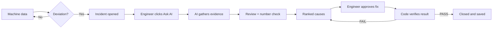
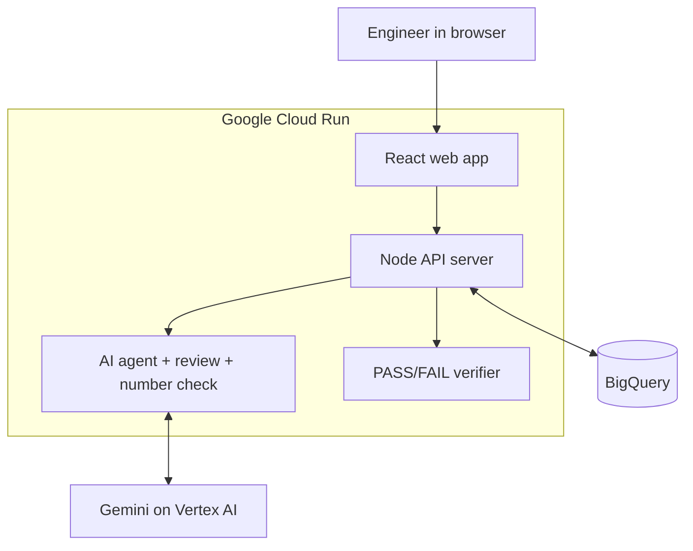

# AshvaTrace: Submission Answers

AI Builder Cup 2026, Manufacturing theme: Intelligent Operations & Industrial Efficiency

- Live app: https://ashvatrace-206380300251.us-central1.run.app
- Code: https://github.com/akanthed/AshvaTrace

---

## 1. Brief about the idea

- Factory machines waste power and break down quietly before anyone notices.
- AshvaTrace watches each machine's power use and flags it when it drifts from normal.
- AI then suggests the likely causes and shows its evidence.
- The engineer picks a fix.
- Plain code, not AI, checks whether the fix worked.
  - After the fix, fixed rules compare the machine's real power, vibration and cycle-time readings against the pre-fix baseline.
  - The result is a clear PASS or FAIL. The AI cannot overrule it, so the engineer gets an honest answer, not an AI's opinion of its own advice.

**In one line:** it spots the problem, explains it, and proves the fix.

---

## 2. How is it different from existing ideas?

- **Other tools:** they show charts and alarms, then leave the diagnosis to people.
- **Other AI tools:** they give a chat answer you have to take on trust.
- **AshvaTrace:**
  - The AI reads real sensor data before it answers.
  - A second AI reviews the first one's work.
  - Code checks that every number quoted is real.
  - Code, not AI, decides if the fix worked.

---

## 3. How will it solve the problem?

- **Problem:** faults like tool wear show up late, and finding the cause takes hours.
- **Step 1, Detect:** it flags a sustained deviation, not a one-off spike.
- **Step 2, Investigate:** the AI checks power, vibration, cycle time, manuals (SOPs) and past fixes.
- **Step 3, Decide:** the engineer sees ranked causes and approves a fix.
- **Step 4, Verify:** code compares the machine before and after, and returns PASS or FAIL.
- **Outcome:** faster diagnosis, less downtime, lower energy cost.

---

## 4. USP of the proposed solution

- **AI proposes, code verifies.** The AI never marks its own homework.
- **No made-up numbers.** Each answer shows "N of M figures match sensor data".
- **Real AI agent.** Gemini fetches live data itself. Nothing is scripted.
- **Remembers history.** "Last time, the fix was X and it worked."
- **Measured, not claimed.** Accuracy and AI cost are tracked from real runs.

---

## 5. Features offered

**Watch**
- Live status for 5 machines: normal, warning or critical.
- Adjustable thresholds and custom dashboards.
- Automatic alerts that clear themselves on recovery.

**Investigate**
- "Ask AI" gives ranked causes with evidence for and against.
- A trace shows exactly what data the AI looked at.
- A second AI review and a code check on every figure.
- Tool-wear check using Vision AI (synthetic image in the prototype).

**Act**
- AI predicts what a proposed fix will do.
- The engineer approves it.
- Code returns PASS or FAIL.

**Review**
- Full audit trail.
- History of open and closed incidents, with cause and fix.
- Energy, cost and AI-spend analytics.
- A chat assistant limited to plant topics.

---

## 6. Process flow diagram

**Users**
- The maintenance engineer investigates and approves.
- The plant manager reviews cost impact and the audit trail.

---

## 7. Architecture diagram

- One container serves the web app and the API.
- BigQuery stores incidents, alerts and settings.

---

## 8. Technologies to be used

- **AI:** Gemini on Vertex AI (tool calling, vision, structured output).
- **Cloud:** Google Cloud Run and BigQuery.
- **Backend:** Node.js, Express, TypeScript.
- **Frontend:** React, Vite, TypeScript.
- **Quality:** Vitest (73 tests) and a custom accuracy test harness.

---

## 9. Estimated implementation cost

These are rough figures. Check them against the Google Cloud billing console.

- **Prototype:** under about $60 per month.
  - Cloud Run: about $25–50.
  - BigQuery: close to free at this size.
  - Gemini: pay per use, and the app shows the cost per incident.
- **Real plant pilot:** about 4–8 weeks of work.
  - Connect real machines.
  - Add login and security.
  - Run on more than one server.
- **Payback:** one avoided breakdown likely covers the running cost.

---

## 10. Prototype performance report / benchmarking

- **Tested on:** 4 faults with known causes, scored by plain code (no AI judge).
- **Correct cause in top 3:** 100%.
- **Correct cause ranked first:** 50–75%, varying by run.
- **Quoted figures matching real data:** 100% in two runs.
- **Reliability:** 73 automated tests pass, and the app is live on Cloud Run.
- **Note:** the data is simulated and the test set is small.
- **To add before submitting:** response time and cost per investigation. Take both from `server/eval-results.json` and the Analytics tab.

---

## 11. Additional details / future development

- Connect to real machines instead of simulated data.
- Warn before a threshold is crossed, not after.
- Learn from every verified fix.
- Add phone alerts and shift handover notes.
- Test on more faults and more machine types.
- Link to maintenance systems.
- Add energy-saving tips and carbon reports.
