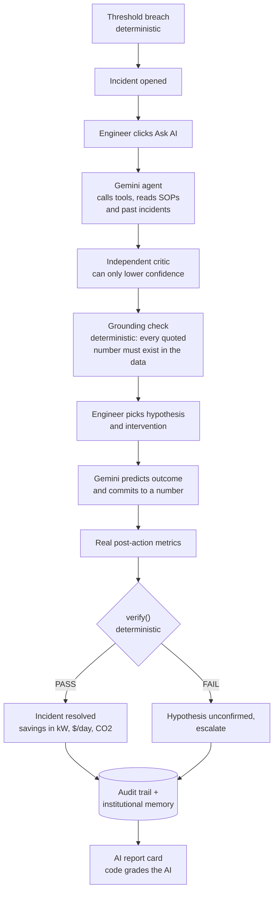
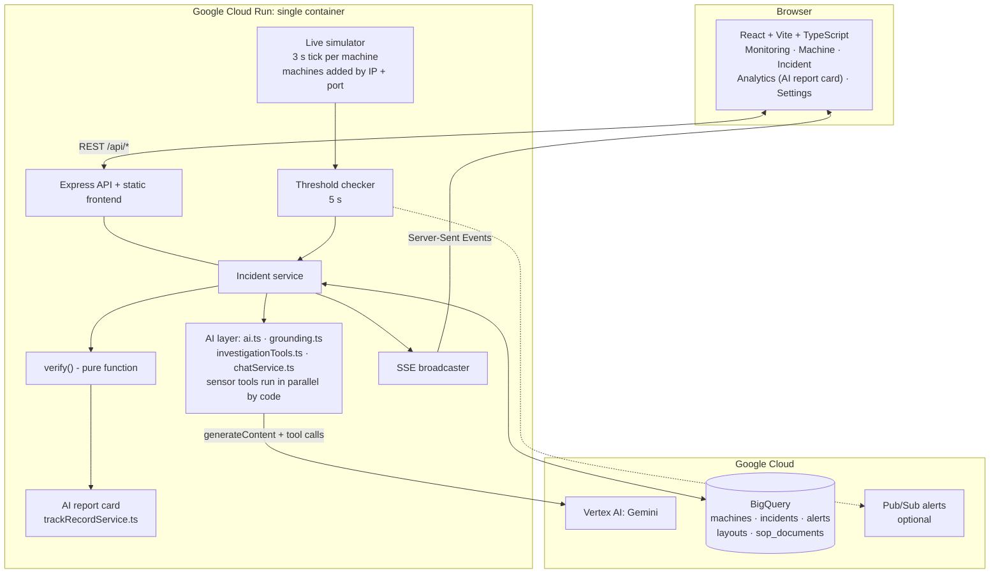
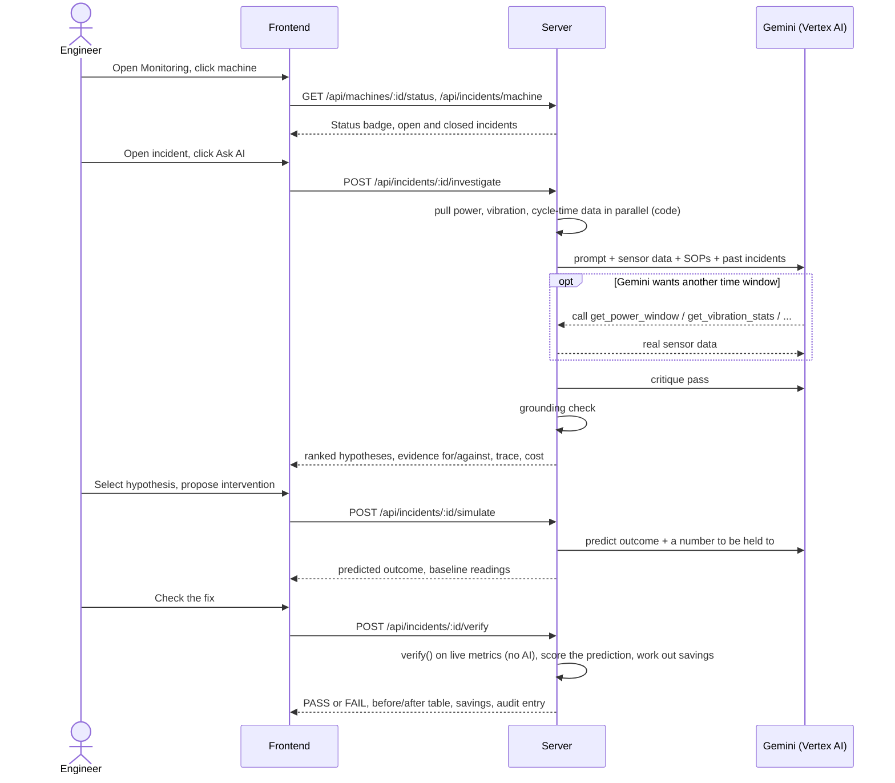

# AshvaTrace

**Detect the signal. Investigate the cause. Verify the improvement.**

AshvaTrace is an evidence-based investigation assistant for factory machines. It spots sustained gaps between a machine's actual and expected power draw, pulls in vibration, cycle-time and event history, and has Gemini investigate like an engineer would: calling tools to fetch real sensor data, citing SOPs and past fixes, and proposing ranked, competing hypotheses. A human approves the fix. **Deterministic code, not AI, decides whether it worked, and keeps score on the AI afterwards.**

> Built for **AI Builder Cup 2026** · Theme: Manufacturing, *Intelligent Operations & Industrial Efficiency* · Team Ashvamedh

| | |
|---|---|
| **Live demo** | https://ashvatrace-206380300251.us-central1.run.app |
| **Hosting** | Google Cloud Run (`us-central1`) |
| **AI** | Gemini on Vertex AI (server-side, Application Default Credentials) |
| **Persistence** | BigQuery |
| **Demo video** | _link added at submission_ |

> **Simulated data.** There is no real PLC, CNC or machine network connection. Machine telemetry is seeded, synthetic data with a live random-walk feed on top. The UI says so on purpose. Gemini calls, BigQuery storage and Cloud Run hosting are all real.

---

## Why it matters

A machine drawing 6% more power than it should is not an alarm. It is a symptom. Worn bearing, dull tool, bad coolant mix, sensor drift: each costs energy, quality and uptime, and each is fixed differently. On the floor, finding the cause means jumping between trend screens, paper SOPs and tribal memory, and nobody checks afterwards whether the fix actually worked.

AshvaTrace closes the whole loop in one place, and keeps AI honest while doing it.

## The core idea: AI proposes, code verifies



Four places where plain code, not a model, has the last word:

| Guardrail | What it does | Where |
|---|---|---|
| **Grounding check** | Every figure, SOP id and past-incident id a hypothesis quotes is checked against what the investigation actually saw. Invented numbers are flagged, confidence is cut, mostly-unsupported hypotheses are dropped. | [server/src/utils/grounding.ts](server/src/utils/grounding.ts) |
| **Critic can only subtract** | A second, independent Gemini call reviews the hypotheses against the real numbers and SOP text. It may lower confidence. It cannot raise it or rewrite evidence. | `critiqueHypotheses()` in [server/src/utils/ai.ts](server/src/utils/ai.ts) |
| **Verification is not AI** | After the action, `verify()` passes only if power deviation is under 3%, vibration under 4.5 mm/s and cycle time under 120 s, on real post-action readings, shown before and after. | `verify()` in [server/src/utils/ai.ts](server/src/utils/ai.ts) |
| **The AI is graded by code** | Before the fix, Gemini commits to the power deviation it expects. After verification, code scores the prediction (within 3 points) and builds a report card: fixes that passed, predictions that held, and stated confidence against real pass rate. | `verify()` and [server/src/services/trackRecordService.ts](server/src/services/trackRecordService.ts) |

Chat is guarded the same way: on-topic enforcement is a forced `onTopic` boolean in the model's structured output, checked by code, so a jailbroken reply still cannot escape the fixed refusal text.

## Gen AI features

- **Agentic investigation.** Code pulls `get_power_window`, `get_vibration_stats` and `get_cycle_time_trend` in parallel up front (this removed a model round-trip and brought "Ask AI" to about 10 seconds). Gemini keeps those same tools and can call them again for a different time window. The trace is shown in plain language with the raw data one click away, and progress streams to the UI over SSE.
- **Retrieval grounding.** SOP-101/102/103 are selected by deterministic rules from live signals (not by the model), plus resolved incidents on the same machine: "last time this happened the fix was X and it worked."
- **Self-critique.** Independent reviewer pass, described above.
- **Vision AI.** A separate "Cutting tool check" on the machine page: Gemini assesses a tool-wear image (condition, wear level, recommendation). It sits outside the investigation loop to keep that fast.
- **Outcome simulation.** Gemini predicts, in plain language, what a proposed fix should do, and commits to a number that code later checks.
- **Scoped assistant.** Chat over live app state only.
- **AI report card.** Analytics shows how often the AI's advice held up when re-checked, with a calibration table ("when the AI said 70%+, fixes passed X% of the time"). Each incident also shows the AI's track record on that machine.
- **Cost and savings, by code.** An open incident shows the electricity the machine is wasting right now. After a PASS, code works out the kW, dollars a day and CO₂ the fix saves, with assumptions on screen.
- **Measured AI cost.** Real token usage from Vertex's `usageMetadata`, converted to dollars and accumulated per incident. Shown in the incident view and Analytics. Not an estimate.

## Architecture



**Key design choices**

- **One container, one deploy.** Express serves both `/api/*` and the built frontend. The multi-stage [Dockerfile](Dockerfile) builds frontend and backend into one image.
- **No secrets in the browser.** Gemini is called only from the server using Application Default Credentials. There is no API key anywhere.
- **BigQuery as the system of record.** Append-only tables; the latest row per id wins on read. State is cached in memory for speed and reloaded on start.
- **Graceful degradation.** No `GCP_PROJECT_ID`: BigQuery is skipped and the app runs in memory. AI failure never fakes a response. The deterministic core (status, alerts, analytics, verification) keeps working.
- **Single-instance by design.** Incident/alert de-duplication is in memory, so Cloud Run is pinned to one instance. Scaling out requires moving create-if-absent into BigQuery. See [Known limitations](#known-limitations).

## Process flow in the app



**Plant page:** machines are added by the IP address and port of their data source (for example an OPC UA gateway on 4840). Addresses are validated, must be unique, and are saved with the machine in BigQuery. The demo never opens a connection to them: readings stay simulated, and the page says so.

**Screens:** Launch · Monitoring (plant table) · Machine (Monitoring, Dashboard, Limits, Trends) · Machine Incidents (open and solved history, with cause, fix tried and result) · Open problems · Incident (Investigate, Fix, Verify, Audit, with a progress bar and a live "costing you right now" banner) · Analytics (AI report card, cost impact, shift summary, energy) · Settings (live check of AI, database and alert connections).

## Tech stack

| Layer | Tech |
|---|---|
| Frontend | React 19, Vite, TypeScript, React Router, Recharts |
| Backend | Node 20, Express, TypeScript |
| AI | Gemini via Vertex AI REST `generateContent` (function calling + vision) |
| Data | BigQuery (`@google-cloud/bigquery`), optional Pub/Sub |
| Realtime | Server-Sent Events |
| Hosting | Cloud Run, Cloud Build / Docker |
| Tests | Vitest (server + frontend), Playwright (e2e) |

## Repository layout

```
.
├── Dockerfile                  # frontend + backend -> one Cloud Run image
├── cloudbuild.yaml
├── TESTING_GUIDE.md            # QA walkthrough of every screen and flow
├── frontend/
│   ├── src/pages/              # Monitoring, Machine, Incident, Analytics, Settings...
│   ├── src/components/         # HypothesisList, InvestigationTrace, AuditLog, ...
│   ├── src/services/api.ts     # typed API client
│   └── e2e/                    # Playwright specs
└── server/
    ├── .env.example            # copy to .env
    └── src/
        ├── index.ts            # boot, live simulator, threshold loop
        ├── routes/ controllers/
        ├── services/           # incident, machine, alert, analytics, sop, chat, bigquery
        ├── utils/ai.ts         # Gemini calls, critique, vision, verify()
        ├── utils/grounding.ts  # deterministic grounding check
        ├── utils/synthetic.ts  # seeded data generator
        └── __tests__/          # Vitest suite (AI layer and BigQuery mocked)
```

## Getting started

### Prerequisites

- Node.js 20+ and npm
- For real AI and persistence: a Google Cloud project with billing, and the `gcloud` CLI

### 1. Clone and install

```bash
git clone https://github.com/akanthed/AshvaTrace.git
cd AshvaTrace
npm --prefix server install --legacy-peer-deps
npm --prefix frontend install --legacy-peer-deps
```

### 2. Configure

```bash
cp server/.env.example server/.env      # Windows PowerShell: Copy-Item server\.env.example server\.env
```

Edit `server/.env`. See [Configuration](#configuration) for every variable.

### 3. Google Cloud setup (for Gemini + BigQuery)

```bash
gcloud auth login
gcloud auth application-default login
gcloud config set project YOUR_PROJECT_ID

gcloud services enable aiplatform.googleapis.com bigquery.googleapis.com \
  run.googleapis.com cloudbuild.googleapis.com pubsub.googleapis.com
```

Set `GCP_PROJECT_ID` in `server/.env`. The BigQuery dataset and tables are created automatically on first start, and the synthetic SOPs are seeded for you.

Your identity (locally) or the Cloud Run service account (deployed) needs: `roles/aiplatform.user`, `roles/bigquery.dataEditor`, `roles/bigquery.jobUser`, and optionally `roles/pubsub.publisher`.

### 4. Run locally

Two terminals:

```bash
# Terminal 1: API on :8080
cd server
npm run dev

# Terminal 2: UI on :5173 (proxies /api to :8080)
cd frontend
npm run dev
```

Open http://localhost:5173. Check wiring at http://localhost:8080/api/system/status or on the in-app **Settings** page.

No GCP credentials? The app still starts with in-memory data and a working deterministic core. AI actions return an error instead of a made-up answer.

### 5. Try the demo flow

1. **Monitoring**: find a machine marked *Action required* (CNC-01, CNC-02, CNC-03, LATHE-01, PRS-01 are live).
2. Click it, open an **open incident**.
3. **Investigate** tab, click **Ask AI** (about 10 seconds). Read the ranked causes, evidence for and against, the quick check and suggested fix for each, and the "code checked" badge. Open "How the AI got here" to see the data it read.
4. Select a cause, then **Next: choose a fix**. The AI's suggested fix is pre-filled. Preview it and read Gemini's prediction.
5. **Verify**: press *Check the machine now*. Code returns PASS or FAIL with a before-and-after table, scores the AI's prediction, and shows the energy, cost and CO₂ the fix saves. In the demo the simulated machine only recovers if you picked the AI's top-ranked cause; pick another and it fails.
6. **Audit**: every step, timestamped.
7. **Analytics**: the AI report card.

**Judges and testers:** no login is needed. Four machines start with an open problem (CNC-02, CNC-03, LATHE-01, PRS-01) and CNC-01 is healthy for comparison. After a problem has been fixed, press **Restore sample problems** (Open problems page or Settings) to close what is open, reset the machines and create fresh problems. Closed incidents stay as history.

### 6. Test

```bash
cd server   && npm run build && npm test     # Vitest (89 tests), AI + BigQuery mocked
cd server   && npm run eval                   # replays 4 known faults through real Gemini; scores top-1/top-3 and figure grounding
cd frontend && npm run build && npm test     # Vitest
cd frontend && npm run test:e2e              # Playwright (optional)
```

### 7. Deploy to Cloud Run

From the repo root:

```bash
gcloud run deploy ashvatrace --source . --region us-central1 --project YOUR_PROJECT_ID \
  --allow-unauthenticated \
  --set-env-vars GCP_PROJECT_ID=YOUR_PROJECT_ID,GCP_LOCATION=us-central1,GEMINI_MODEL=gemini-3.8-flash

# Required: state and de-duplication live in process memory
gcloud run services update ashvatrace --region us-central1 --project YOUR_PROJECT_ID \
  --min-instances=1 --max-instances=1
```

Do not set `GOOGLE_APPLICATION_CREDENTIALS` on Cloud Run; the attached service account is used. Verify after deploying:

```bash
curl https://<your-service-url>/health
curl https://<your-service-url>/api/system/status
```

## Configuration

All variables are read by the server. Template: [server/.env.example](server/.env.example).

| Variable | Default | Purpose |
|---|---|---|
| `PORT` | `8080` | HTTP port (Cloud Run sets it) |
| `GCP_PROJECT_ID` | none | Enables Vertex AI and BigQuery. Required for AI. |
| `GCP_LOCATION` | `us-central1` | Vertex AI region |
| `GOOGLE_APPLICATION_CREDENTIALS` | none | Local key file path. Omit to use `gcloud` ADC. Not used on Cloud Run. |
| `GEMINI_MODEL` | `gemini-3.8-flash` | Model for all AI calls |
| `GEMINI_INPUT_USD_PER_1M` | `0.10` | Input price for cost display |
| `GEMINI_OUTPUT_USD_PER_1M` | `0.40` | Output price for cost display |
| `BIGQUERY_DATASET` | `ashvatrace` | Dataset name (auto-created) |
| `PUBSUB_ALERT_TOPIC` | none | Publish alerts to this topic when set |
| `LIVE_AUTO_INVESTIGATE` | `false` | `true` makes Gemini investigate every new critical incident automatically |

## API

| Area | Endpoints |
|---|---|
| System | `GET /health`, `GET /api/system/status`, `POST /api/system/reset-demo` |
| Machines | `GET/POST /api/machines` (a new machine needs `ip` and `port`; invalid or duplicate addresses are rejected), `GET/PUT/DELETE /api/machines/:id`, `GET /api/machines/:id/status`, `/series`, `POST /api/machines/:id/inspect-tool` |
| Incidents | `GET /api/incidents`, `/api/incidents/machine?machineId=`, `/api/incidents/:id`, `/:id/audit`, `/:id/similar` |
| Investigation loop | `POST /api/incidents/:id/investigate`, `/simulate`, `/verify`; `PATCH /api/incidents/:id/status` |
| Alerts | `GET /api/alerts`, `/api/alerts/machine/:id`, `POST /api/alerts/:id/acknowledge` |
| Analytics | `GET /api/analytics/shift-summary`, `/threshold-violations`, `/energy-report`, `/machine-comparison`, `/cost-impact`, `/track-record?machineId=` |
| Assistant | `POST /api/chat/ask` |
| Dashboards | `GET/PUT /api/dashboard-layout/:machineId` |
| Realtime | `GET /api/sse/events` |

## Safety and honesty

- Synthetic demonstration only. No commands are ever sent to equipment.
- AI output is hypotheses, not proof of causation, and is labelled that way.
- Hypotheses appear only when the engineer asks. They are never passed off as automatic findings.
- 13 resolved past incidents are seeded (two fixes that did not work, on purpose) so the AI has history to cite and the report card has real variety.
- In the demo, the simulated machine recovers after a fix only if the engineer picked the AI's top-ranked cause. The Verify tab says so on screen.
- Costs and energy figures are estimates from displayed assumptions. AI cost is measured, not estimated.
- Credentials never reach the browser. Key files and `.env` files are git-ignored.

## Known limitations

- Horizontal scaling is unsafe until incident and alert creation moves to an atomic BigQuery check-and-create. Cloud Run is pinned to a single instance for this reason.
- Incidents for a machine deleted before cascade-delete existed can be orphaned.
- The seeded incident history is all passes, so the report card looks better than real use would. It becomes meaningful as real fixes are graded.
- Verification uses fixed global criteria (3% / 4.5 mm/s / 120 s); per-machine criteria are future work.

## Roadmap

Real OPC UA / MQTT ingestion in place of the simulator, per-machine verification criteria, SOP upload and embedding retrieval, CMMS work-order hand-off, multi-instance safe state.

## Documentation

- [TESTING_GUIDE.md](TESTING_GUIDE.md): plain-language QA walkthrough of every screen

## Hackathon

[AI Builder Cup 2026](https://aibuildercup.com/) · Manufacturing theme. Public repository: https://github.com/akanthed/AshvaTrace
